# Piel Viva — Identidad visual

**Brandbook v1 · Noviembre 2026**
Identidad visual para Piel Viva SAS, importadora de café verde de especialidad colombiano con sede en París.

🔗 **Ver el brandbook:** abre `index.html` o el enlace publicado en Cloudflare Pages.
Es una historia de principio a fin con un lenguaje editorial: portada que se aleja, paneles con arco que suben como cortina, títulos que aparecen línea a línea con calma y dos escenas fijas donde piezas en arco cruzan el título (texturas y paleta). El prólogo ilumina el texto palabra a palabra al hacer scroll. Solo usa los colores y tipografías de la marca. El contenido tiene un ancho máximo de 1440 px y se adapta a computador y móvil.

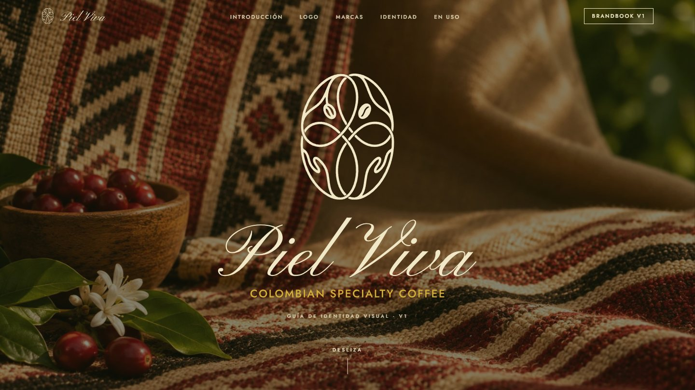

---

## El proyecto

| | |
|---|---|
| **Cliente** | Piel Viva SAS (París 12e, creada en 2026) |
| **Fundadoras** | Mónica y Cielo, socias al 50 %, entre Colombia y París |
| **Sector** | Café verde de especialidad (B2B) · futuro café tostado y bio-textil |
| **Alcance** | Logo vectorial, declinaciones, sistema de color, tipografía, texturas, dirección fotográfica, aplicaciones y brandbook |
| **Formato** | Experiencia web de scroll narrativo (React, GSAP y Lenis), autocontenida en un solo archivo HTML |

### El reto
Piel Viva importa café verde de especialidad colombiano para los tostadores independientes de París. En Francia ya existen otras importadoras de café colombiano, así que la identidad tenía que distinguirse de ellas y funcionar en dos tiempos:

- **Hoy:** B2B, para tostadores y restauración.
- **Mañana:** consumidor final, con café tostado de marca propia, y la moda de lujo, con un bio-textil hecho a partir de la cáscara del café.

La dirección del brief se resume en una frase: **«El Loro Piana del café colombiano»**. Materia prima excepcional, marca aspiracional.

### La idea
**El café y el tejido son un mismo gesto.**
El nombre ya lo contenía:

- **Piel:** la textura del grano y el contacto de la mano con el fruto.
- **Viva:** el origen, la vida de cada finca.
- **Segunda vida:** del fruto solo viaja el grano; su piel, la cáscara, puede volver como material.

La identidad entera se construye sobre el **tejido hecho a mano**: memoria de los pueblos andinos, oficio de manos de mujer y fibra de la misma tierra del café. Piel Viva, fundada por dos mujeres, toma ese mismo gesto.

---

## Estructura de la guía

La web sigue la estructura de una guía de identidad visual, en cinco capítulos con su página divisoria:

1. **Introducción:** dirección creativa, memoria, el fruto y esencia (la historia de la marca).
2. **Sistema de logo:** logomark, wordmark, combinaciones y fondos, geometría y zona de respeto, usos incorrectos.
3. **Marcas extendidas:** sello circular, perfiles de redes y marcas por línea de producto.
4. **Identidad visual:** tipografía, color (paleta y especificaciones), textura, fotografía y patrón.
5. **La marca en uso:** packaging con el logo real.

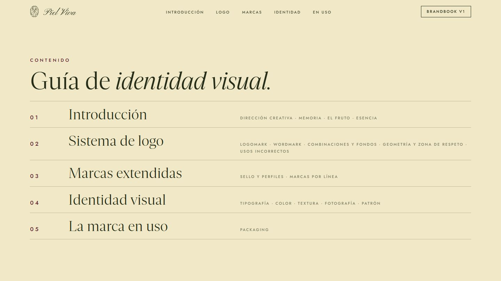

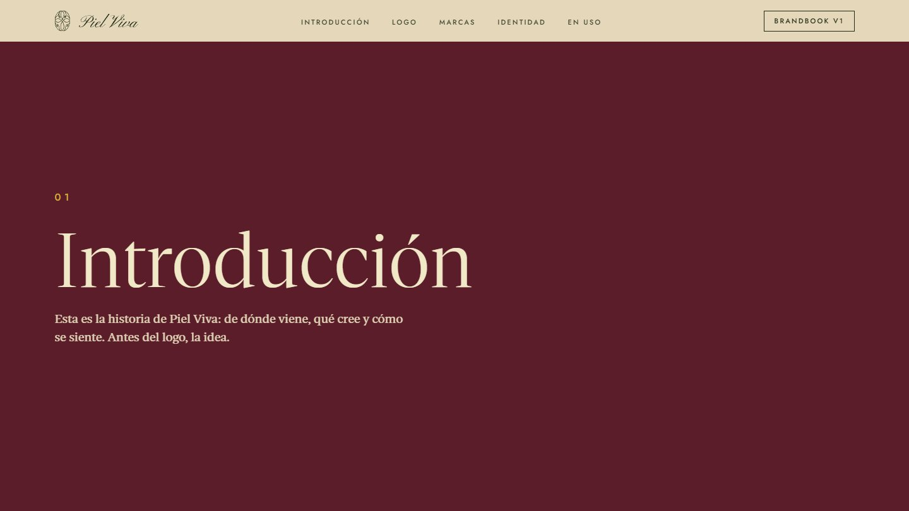

### Logo
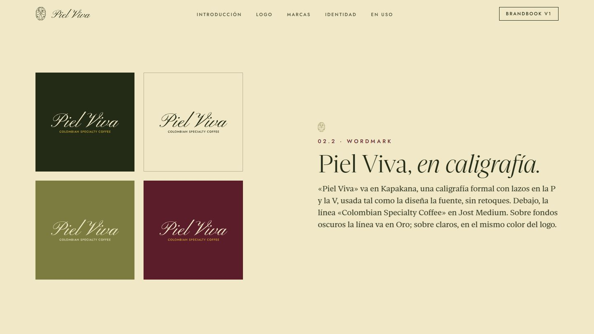

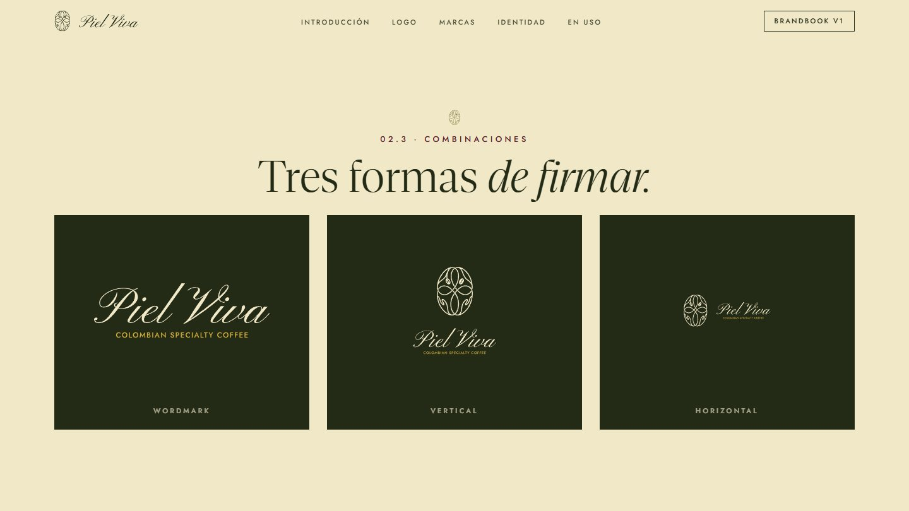

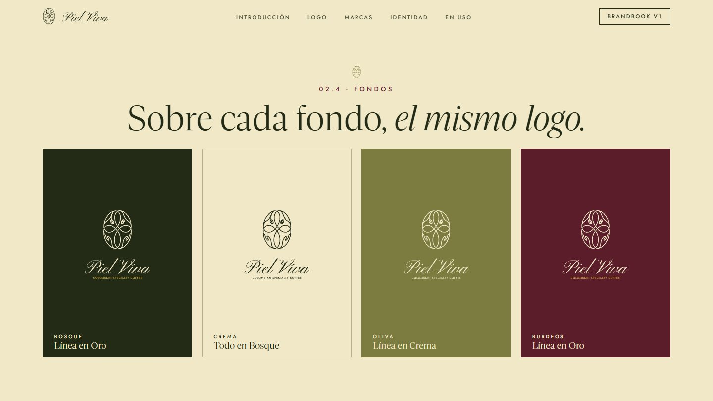

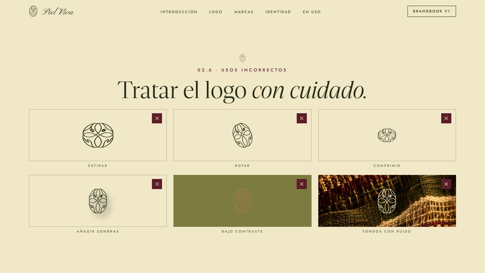

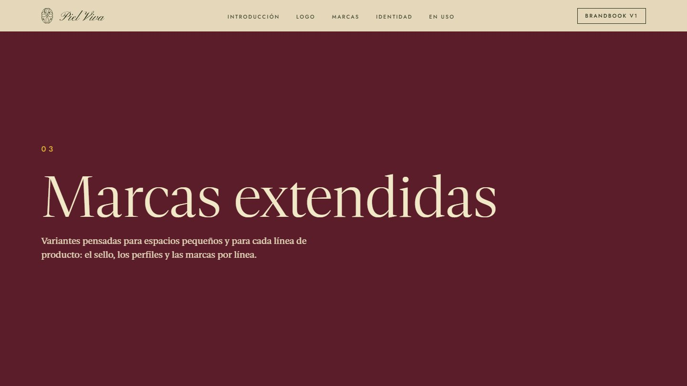

### Marcas extendidas
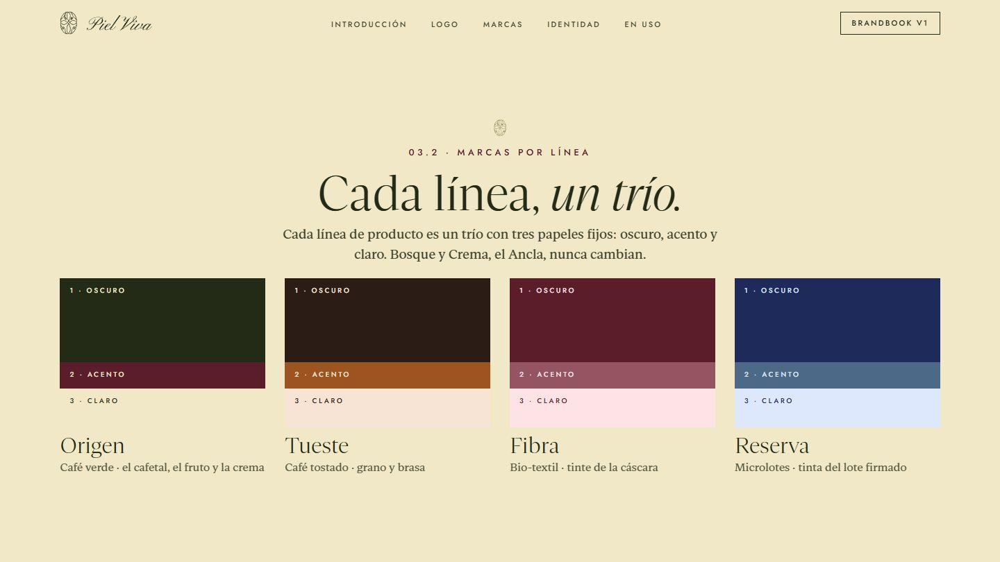

### Identidad visual
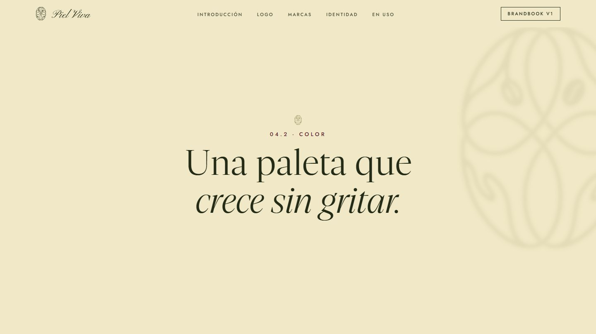

### La marca en uso
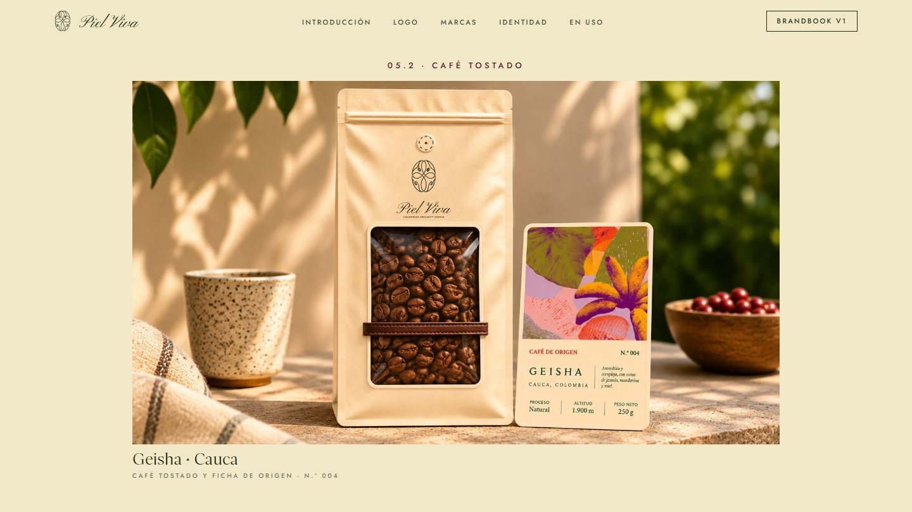

---

## Proceso

1. **Análisis del brief y de las referencias:** Topia Coffee, Nía, Neroli House y Hechizoo.
2. **Vectorización del logo:** reconstrucción del símbolo y del wordmark como vector limpio.
3. **Sistema de color:** tres propuestas, de las que se eligió Bosque & Cereza, con el acento cambiado después a Burdeos para un tono más sobrio. Después, jerarquía, contraste medido (WCAG) y mundos de producto.
4. **Texturas y fotografía:** dirección inspirada en el textil artesanal colombiano e imágenes generadas como textura y atmósfera.
5. **Tipografía:** Gestura con Jost, y jerarquía tipo design system.
6. **Brandbook:** presentación HTML 16:9 con un diseño visual primero y el texto justo.

## Entregables
- Símbolo, wordmark y lockups en SVG vectorial, con la tagline convertida a trazos.
- Paleta y tokens (CSS y JSON).
- Brandbook interactivo (`index.html`).

## Créditos
- **Diseño de identidad y brandbook:** Sebastián Londoño.
- **Cliente:** Piel Viva SAS. Mónica y Cielo.
- **Tipografías:** Gestura (versión de prueba), Kapakana y Jost (SIL Open Font License).
- **Imágenes de textura:** generadas con IA como textura y atmósfera, no como registro de fincas o personas reales.

---

*Primera versión (v1). La tipografía Gestura se usa en versión de prueba; para un uso comercial hay que adquirir su licencia.*
