# Piel Viva — Identidad visual

**Brandbook v1 · Noviembre 2026**
Identidad visual para Piel Viva SAS, importadora de café verde de especialidad colombiano con sede en París.

🔗 **Ver el brandbook:** abre `index.html` o el enlace publicado en Cloudflare Pages.
En computador se navega con las flechas del teclado o con clic a izquierda y derecha. En el móvil se lee como una página con scroll.

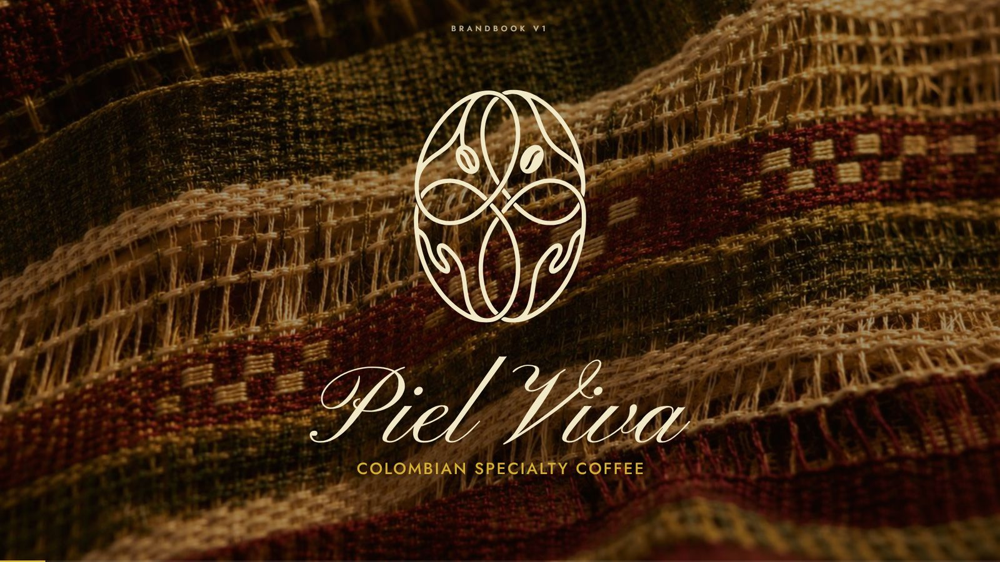

---

## El proyecto

| | |
|---|---|
| **Cliente** | Piel Viva SAS (París 12e, creada en 2026) |
| **Fundadoras** | Mónica y Cielo, socias al 50 %, entre Colombia y París |
| **Sector** | Café verde de especialidad (B2B) · futuro café tostado y bio-textil |
| **Alcance** | Logo vectorial, declinaciones, sistema de color, tipografía, texturas, dirección fotográfica, aplicaciones y brandbook |
| **Formato** | Presentación HTML de 22 slides, 16:9, autocontenida |

### El reto
Piel Viva importa café verde de especialidad colombiano para los tostadores independientes de París. En Francia ya existen otras importadoras de café colombiano, así que la identidad tenía que distinguirse de ellas y funcionar en dos tiempos:

- **Hoy:** B2B, para tostadores y restauración.
- **Mañana:** consumidor final, con café tostado de marca propia, y la moda de lujo, con un bio-textil hecho a partir de la cáscara del café.

La dirección del brief se resume en una frase: **«El Loro Piana del café colombiano»**. Materia prima excepcional, marca aspiracional.

### La idea
**El café y el tejido son un mismo gesto.**
El nombre ya lo contenía:

- **Piel:** la textura del grano y el contacto de la mano con el fruto.
- **Viva:** el origen, la vida de cada finca.
- **Circular:** lo que otros desechan, Piel Viva lo transforma, del residuo al bio-textil.

La identidad entera se construye sobre el **tejido hecho a mano**. El tejido es memoria: antes de la llegada de los europeos ya era un lenguaje en los pueblos andinos, estuvo ligado a las manos de las mujeres y nace de una relación íntima con el territorio. Piel Viva, fundada por dos mujeres, toma ese mismo gesto.

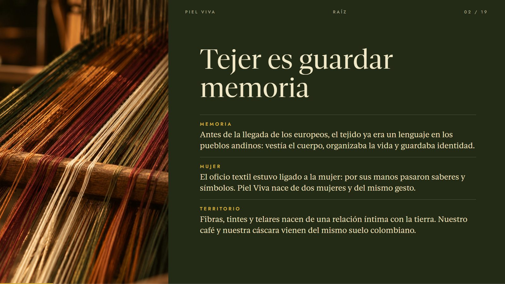

---

## La historia

Piel Viva cuenta su origen en cuatro capítulos, y el brandbook se lee en ese orden:

1. **Memoria.** Tejer es guardar memoria: el tejido ya era un lenguaje antes de la llegada de los europeos y estuvo ligado a las manos de las mujeres.
2. **Residuo.** Lo que otros desechan, nosotras lo transformamos. El café deja millones de toneladas de cáscara al año, y casi toda se desecha o se quema.
3. **Transformación.** La cáscara vuelve como material: **fibra, tejido, piel y papel**. El concepto no es solo tela de café, sino materiales hechos de café.
4. **Esencia.** Un Creador con alma de Cuidador convierte el residuo en material, y esa personalidad ordena el logo, el color y la tipografía.

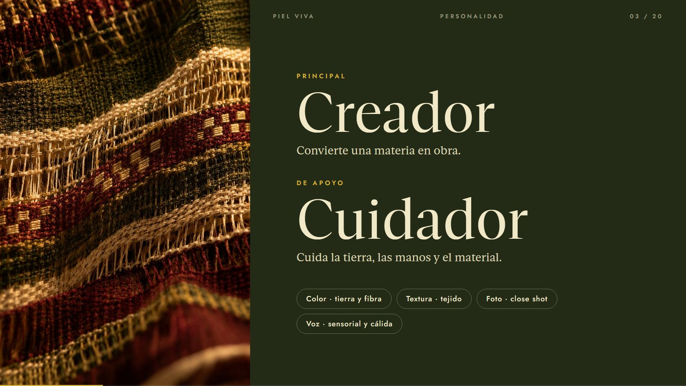

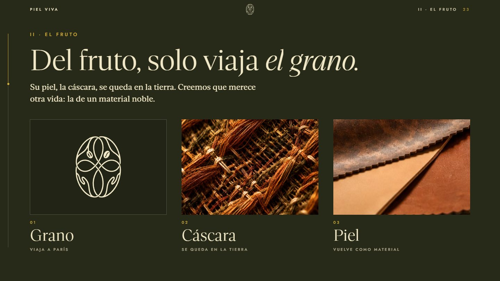

> Las imágenes de materiales (tejido, piel, papel) se generaron con IA para ilustrar el concepto. La piel y el papel de cáscara son una idea del proyecto, todavía en fase de I+D, no productos existentes.

## Personalidad

**El Creador, con alma de Cuidador.**

- **Creador:** convierte una materia en obra, del grano al tejido.
- **Cuidador:** cuida la tierra, las manos y el material.

Eso se traduce en un color de tierra y fibra, una textura de tejido a mano, fotografía en close shot con luz cálida, y una voz sensorial en francés, cálida en español y experta en inglés.

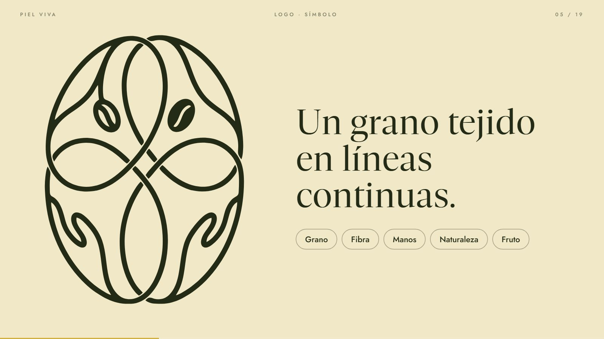

---

## Logo

### Símbolo
Un grano de café trazado en **líneas continuas que se cruzan como un tejido**. Reúne cinco ideas: el grano, la fibra, las manos femeninas que lo sostienen, la naturaleza y la cereza.

El logo original era una imagen rasterizada. Se reconstruyó como **vector real**: curvas Bézier suaves, un grosor de trazo uniforme y granos reflejados con simetría exacta.

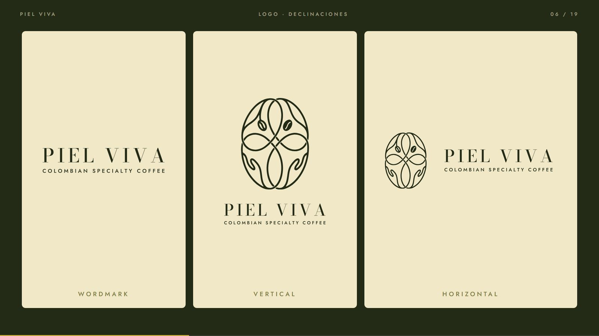

### Geometría y zona de respeto
- Sus curvas son continuas y simétricas sobre un eje vertical. Al medirlas, encajan en **círculos de proporción áurea**, cada uno 1,618 veces menor que el anterior.
- **Zona de respeto:** un margen libre del tamaño de una pepita de café (x) en los cuatro lados. La marca se mide con su propio origen.
- **Tamaños mínimos:** símbolo de 32 px y wordmark de 140 px.

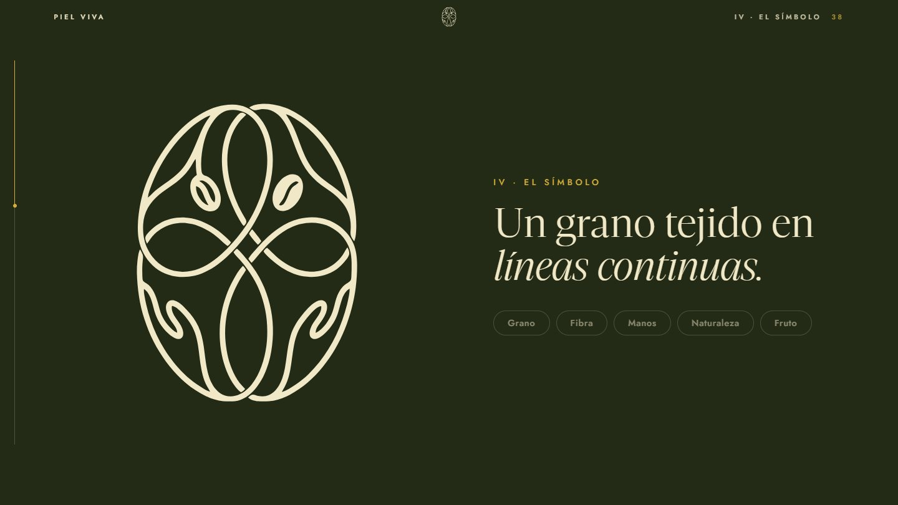

### Declinaciones
Wordmark, lockup vertical y lockup horizontal. «Piel Viva» va en **Kapakana**, una caligrafía formal con lazos en la P y la V (Google Fonts, licencia OFL), usada tal como la diseña la fuente, sin retoques. Su tamaño se calibró para que el wordmark tenga el mismo peso visual que el símbolo cuando van juntos.

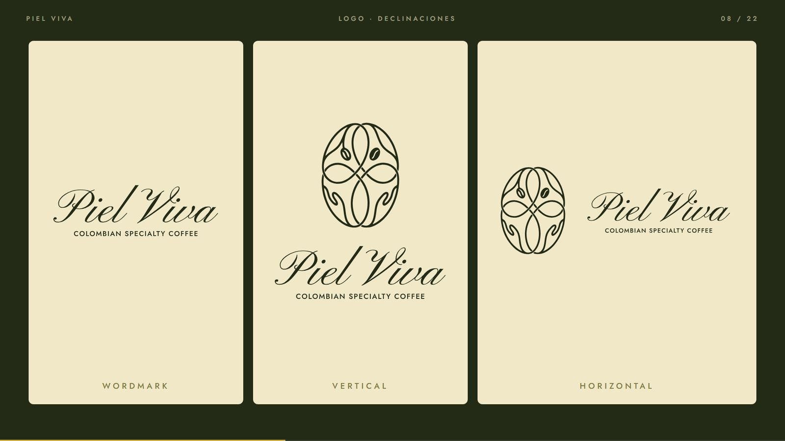

---

## Tipografía

| Fuente | Rol | Por qué |
|---|---|---|
| **Gestura** (serif) | Titulares y textos | Cortes rectos y terminaciones elegantes, con pesos de Thin a Black. Sostiene el lujo silencioso y da jerarquía sin sumar fuentes. |
| **Jost** (sans) | Etiquetas y datos | Geométrica y equilibrada, limpia. Hace de contrapeso a la serif y se lee bien en tamaños pequeños. |

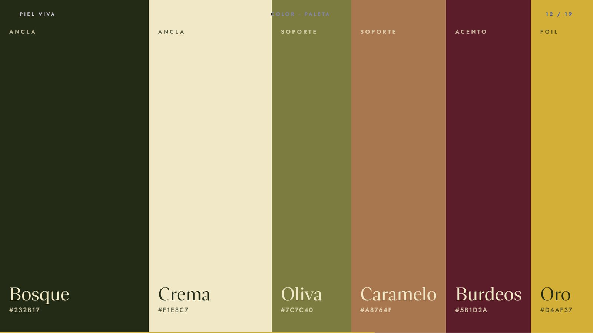

### Jerarquía

| Estilo | Fuente | Tamaño (lienzo 1920 px) |
|---|---|---|
| Titular | Gestura Display Regular | 96 / 100 px |
| Subtítulo | Gestura Display Light | 56 / 62 px |
| Texto | Gestura Text Regular | 30 / 42 px |
| Etiqueta | Jost Medium, mayúsculas, +30 % | 20 px |
| Dato | Jost Regular | 26 / 32 px |

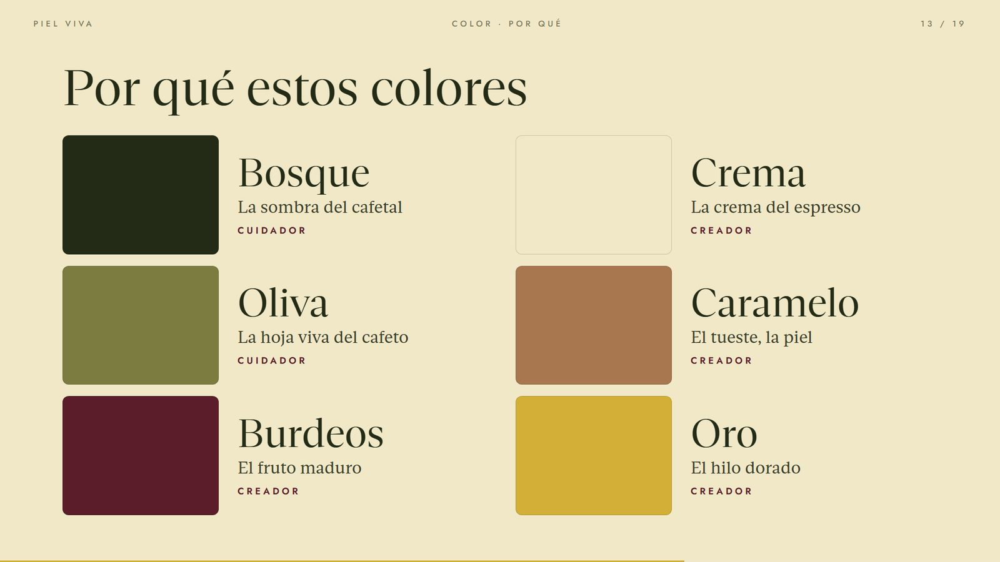

---

## Color

### Paleta con jerarquía
| Rol | Color | Hex | Presencia |
|---|---|---|---|
| Ancla | Bosque | `#232B17` | Siempre presente |
| Ancla | Crema | `#F1E8C7` | Siempre presente |
| Soporte | Oliva | `#7C7C40` | Apoyo |
| Soporte | Caramelo | `#A8764F` | Apoyo |
| Acento | Burdeos | `#5B1D2A` | Un solo punto por pieza |
| Foil | Oro | `#D4AF37` | Detalle de lujo, solo sobre fondos oscuros (≥ 6:1) |

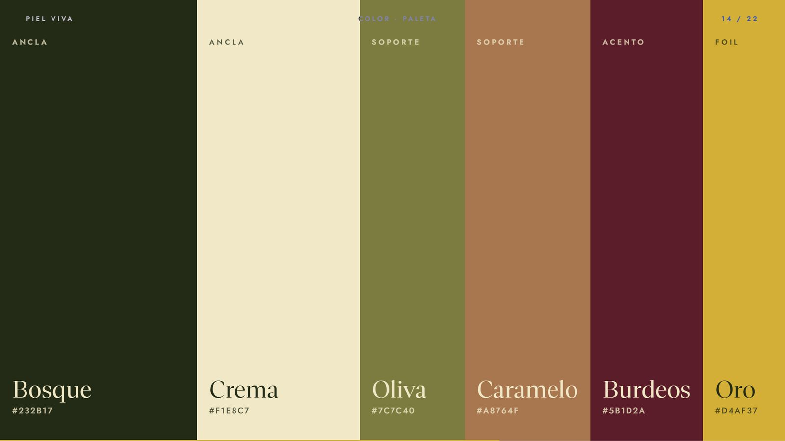

### Por qué estos colores
Cada color sale de una parte del proceso, de la finca al tejido:

- **Bosque:** la sombra del cafetal.
- **Crema:** la crema del espresso.
- **Oliva:** la hoja viva del cafeto.
- **Caramelo:** el tueste y la piel.
- **Burdeos:** el fruto maduro.
- **Oro:** el hilo dorado.

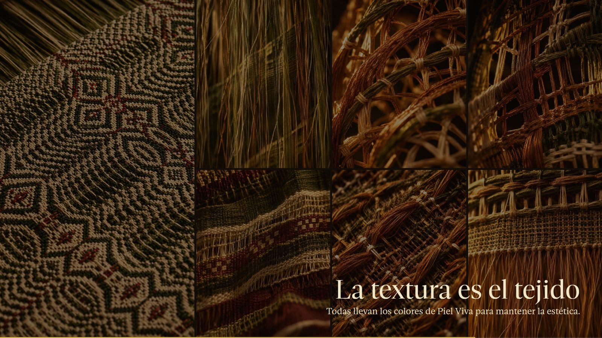

### Cómo crece la paleta
Cada línea de producto es un **trío** con tres papeles fijos: **oscuro** (el material, va de fondo), **acento** (su historia, en un solo punto) y **claro** (la luz del mismo color). El Ancla (Bosque y Crema) no cambia nunca.

| Línea | Oscuro | Acento | Claro |
|---|---|---|---|
| Origen · café verde | Bosque `#232B17` | Burdeos `#5B1D2A` | Crema `#F1E8C7` |
| Tueste · café tostado | Espresso `#2B1D16` | Cobre `#9D5421` | `#F8E4D4` |
| Fibra · bio-textil | Burdeos `#5B1D2A` | Rubor `#945461` | Rosa `#FDE3E6` |
| Reserva · microlotes | Tinta `#1E2B5A` | Azul piedra `#4C6988` | `#DEE8FD` |

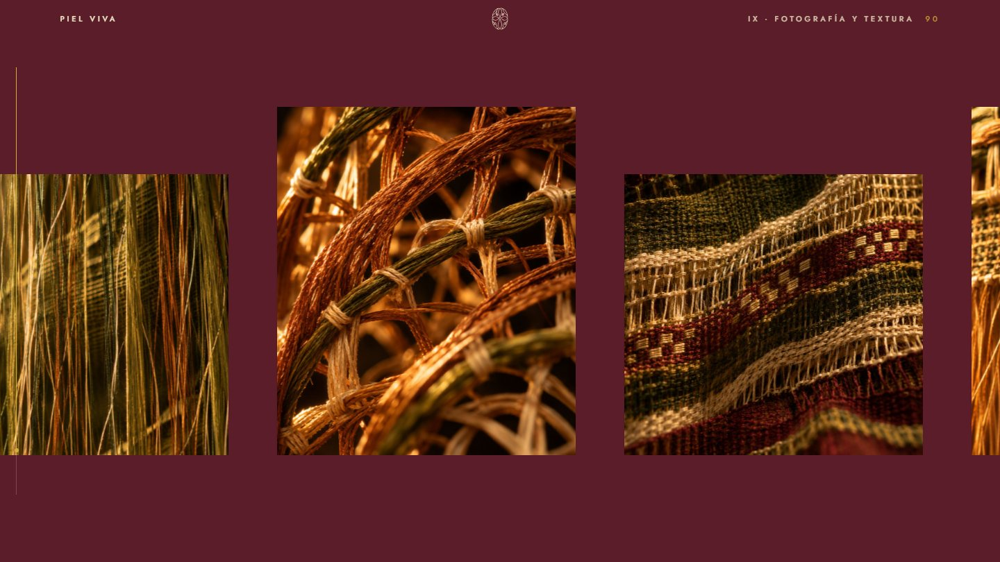

---

## Texturas y fotografía

**La textura es el tejido.** Urdimbre, trama, hilos sueltos y nudos vistos de cerca. Todas las texturas llevan los colores de Piel Viva para mantener la estética.

**Dirección fotográfica:**
- **Close shot:** macro con un solo punto en foco y bokeh cremoso.
- **Contraste alto:** negros profundos, nunca grises lavados.
- **Luz cálida:** ámbar, lateral o a contraluz.
- **Textura de oficio:** tejido a mano, con su imperfección.
- **La mano:** manos de artesana, sin rostro.

Las fincas, los productores y los lotes concretos se muestran siempre con fotografía real.

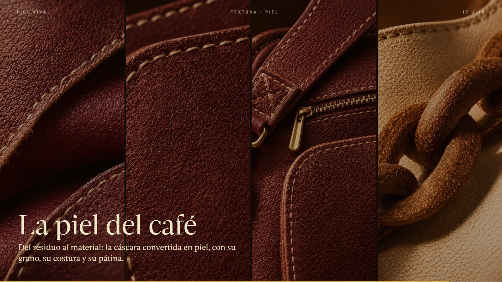

**La piel del café.** Del residuo al material: la cáscara convertida en piel, con su grano, su costura y su pátina.

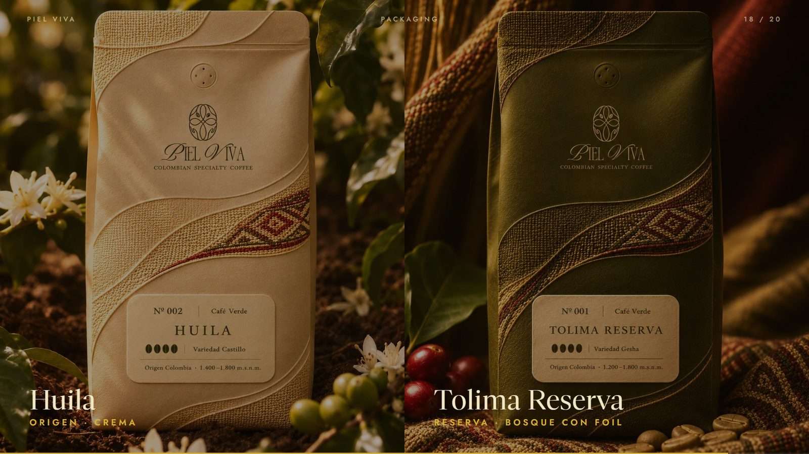

---

## Aplicaciones

Packaging de café en tres referencias (Caturra de Huila, Geisha del Cauca y Tolima), que muestran cómo la paleta crece por línea: verde, crema y burdeos. Y las tarjetas de presentación.

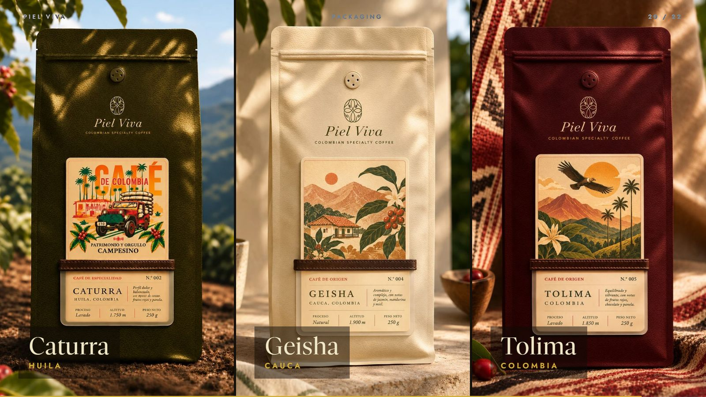

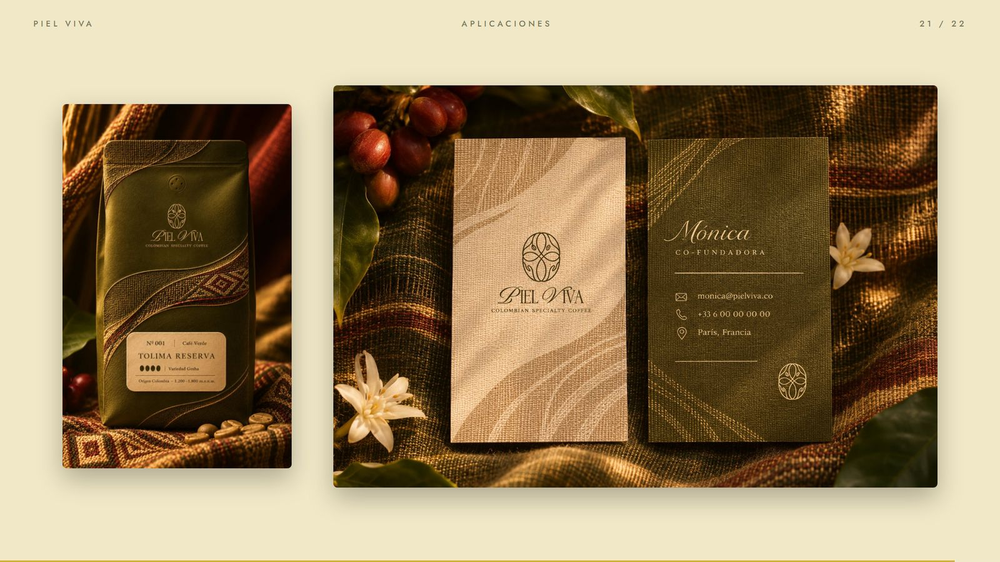

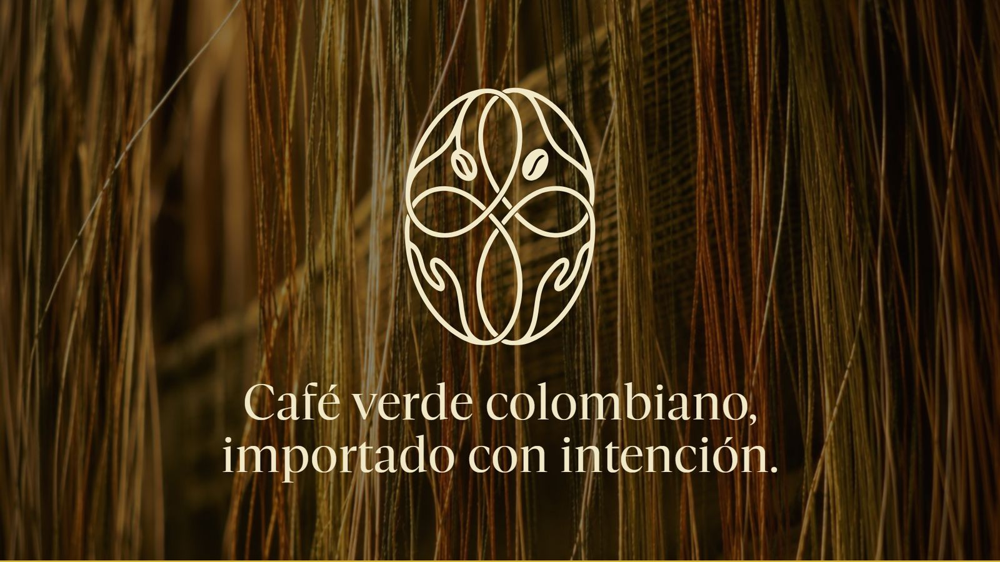

---

## Proceso

1. **Análisis del brief y de las referencias:** Topia Coffee, Nía, Neroli House y Hechizoo.
2. **Vectorización del logo:** reconstrucción del símbolo y del wordmark como vector limpio.
3. **Sistema de color:** tres propuestas, de las que se eligió Bosque & Cereza, con el acento cambiado después a Burdeos para un tono más sobrio. Después, jerarquía, contraste medido (WCAG) y mundos de producto.
4. **Texturas y fotografía:** dirección inspirada en el textil artesanal colombiano e imágenes generadas como textura y atmósfera.
5. **Tipografía:** Gestura con Jost, y jerarquía tipo design system.
6. **Brandbook:** presentación HTML 16:9 con un diseño visual primero y el texto justo.

## Entregables
- Símbolo, wordmark y lockups en SVG vectorial, con la tagline convertida a trazos.
- Paleta y tokens (CSS y JSON).
- Brandbook interactivo (`index.html`).

## Créditos
- **Diseño de identidad y brandbook:** Sebastián Londoño.
- **Cliente:** Piel Viva SAS. Mónica y Cielo.
- **Tipografías:** Gestura (versión de prueba), Kapakana y Jost (SIL Open Font License).
- **Imágenes de textura:** generadas con IA como textura y atmósfera, no como registro de fincas o personas reales.

---

*Primera versión (v1). La tipografía Gestura se usa en versión de prueba; para un uso comercial hay que adquirir su licencia.*
